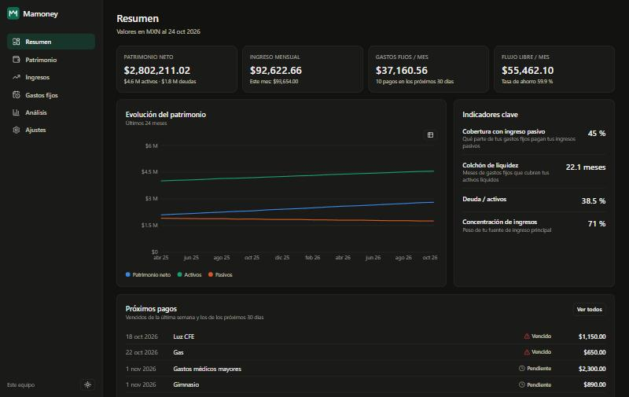
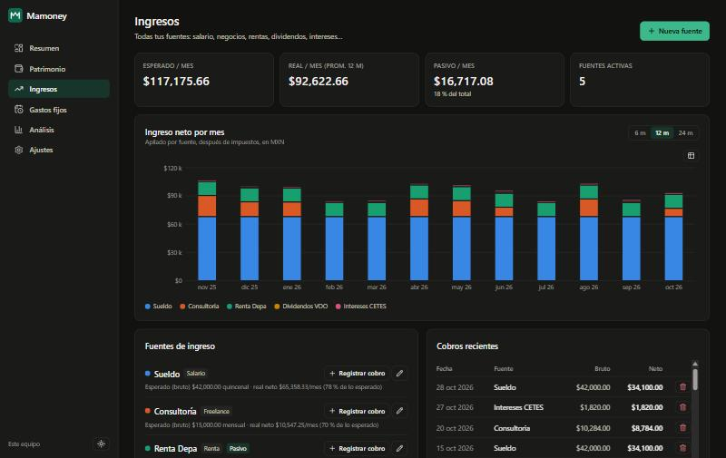
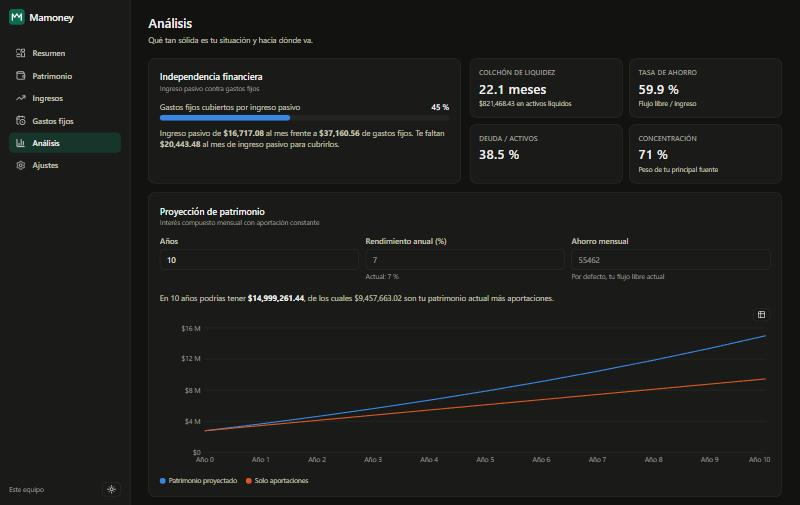
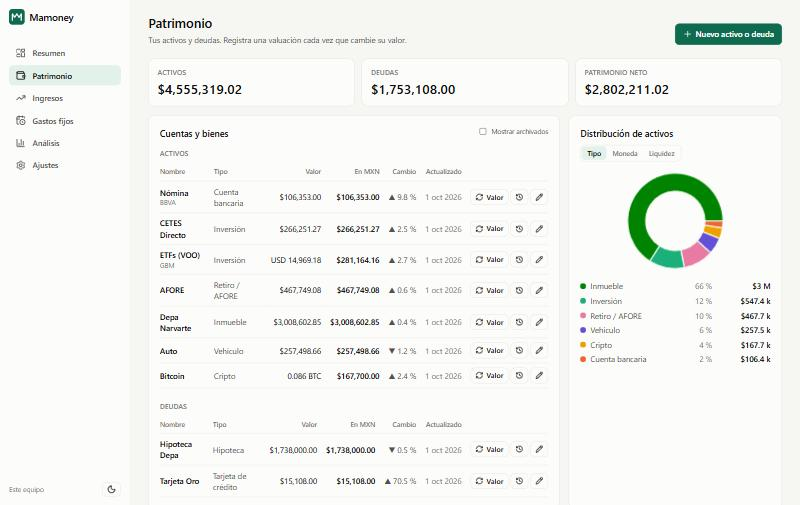
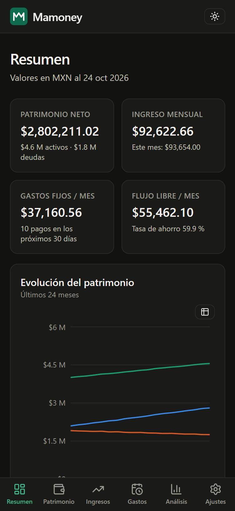
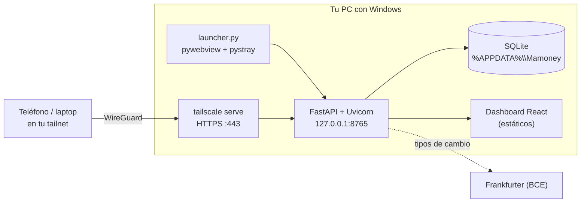

<div align="center">


# Mamoney

**Tu patrimonio, tus ingresos y tus gastos fijos en un solo lugar.**
App de escritorio para Windows con dashboard web privado, accesible desde tu teléfono vía Tailscale.

[](https://github.com/ahiram1701/Mamoney/actions/workflows/ci.yml)
[](https://github.com/ahiram1701/Mamoney/releases)
[](LICENSE)




</div>

---

## Contenido

- [Por qué Mamoney](#por-qué-mamoney)
- [Funciones](#funciones)
- [Capturas](#capturas)
- [Instalación](#instalación)
- [Acceso remoto con Tailscale](#acceso-remoto-con-tailscale)
- [Actualizaciones](#actualizaciones)
- [Privacidad y seguridad](#privacidad-y-seguridad)
- [Arquitectura](#arquitectura)
- [Desarrollo](#desarrollo)
- [Publicar una versión](#publicar-una-versión)
- [Roadmap](#roadmap)
- [Licencia](#licencia)

## Por qué Mamoney

La mayoría de las apps de finanzas personales viven en la nube, piden acceso a tus bancos
y se centran en gastos del día a día. Mamoney está pensado para otra pregunta:
**¿cuánto vale todo lo que tengo, de dónde viene mi dinero y cuánto me cuesta vivir cada mes?**

- **Tus datos nunca salen de tu equipo.** Una base SQLite local, sin cuentas ni servidores de terceros.
- **Todo tipo de patrimonio y de ingreso**: cuentas, inversiones, AFORE, inmuebles, cripto, deudas;
  sueldo, freelance, rentas, dividendos, intereses, regalías…
- **Multimoneda con base en MXN**: los tipos de cambio se actualizan solos y cada registro conserva su moneda original.
- **En tu escritorio y en tu bolsillo**: ventana nativa en Windows y el mismo dashboard en tu
  teléfono a través de tu red privada de Tailscale.

## Funciones

| Módulo | Qué hace |
|---|---|
| **Resumen** | Patrimonio neto, ingreso mensual, gastos fijos, flujo libre, tasa de ahorro, evolución a 24 meses y próximos pagos. |
| **Patrimonio** | Activos y deudas con historial de valuaciones, variación, liquidez y distribución por tipo, moneda y liquidez. |
| **Ingresos** | Fuentes activas y pasivas, cobros con impuestos retenidos, ingreso neto por mes apilado por fuente, esperado vs. real. |
| **Gastos fijos** | Pagos recurrentes de cualquier frecuencia (semanal a anual, incluido bimestral y quincenal), calendario de vencimientos, marcar como pagado, atrasos. |
| **Análisis** | Cobertura de gastos con ingreso pasivo, colchón de liquidez en meses, deuda/activos, concentración de ingresos, rendimiento por activo y proyección de patrimonio con interés compuesto. |
| **Ajustes** | Tipos de cambio (automáticos y manuales), usuarios de Tailscale permitidos, PIN, respaldo `.db`, exportación e importación JSON. |

Además: modo claro y oscuro, diseño responsive, vista de tabla accesible para cada gráfica,
paleta validada para daltonismo, respaldo con un clic desde el icono de la bandeja y
actualizaciones verificadas con un clic.

## Capturas

| Ingresos | Análisis |
|---|---|
|  |  |

| Patrimonio (tema claro) | Móvil vía Tailscale |
|---|---|
|  |  |

## Instalación

### Opción 1: ejecutable para Windows (recomendada)

1. Descarga `Mamoney-vX.Y.Z-windows-x64.zip` de la página de [Releases](https://github.com/ahiram1701/Mamoney/releases).
2. (Opcional) Verifica la integridad con el archivo `.sha256`:
   ```powershell
   Get-FileHash .\Mamoney-vX.Y.Z-windows-x64.zip -Algorithm SHA256
   ```
3. Descomprime y ejecuta `Mamoney\Mamoney.exe`.
4. En el icono de la bandeja activa **Iniciar con Windows** para que el dashboard esté siempre disponible.

> Requiere Windows 10/11 con Microsoft Edge WebView2 (incluido en Windows 11).
> Tus datos se guardan en `%APPDATA%\Mamoney`.
>
> La primera vez, Windows SmartScreen puede advertir que la app no está firmada:
> elige **Más información → Ejecutar de todas formas**. Si algo falla al iniciar, el detalle
> queda en `%APPDATA%\Mamoney\mamoney.log`.

### Opción 2: desde el código

Requisitos: [Python 3.12+](https://www.python.org/), [uv](https://docs.astral.sh/uv/) y [Node.js 24+](https://nodejs.org/).

```bash
git clone https://github.com/ahiram1701/Mamoney.git
cd Mamoney
uv sync --all-extras
npm --prefix frontend ci
npm --prefix frontend run build
uv run python launcher.py
```

## Acceso remoto con Tailscale

Mamoney escucha **solo en `127.0.0.1`**. Para verlo desde tu teléfono o laptop se publica
dentro de tu tailnet con [`tailscale serve`](https://tailscale.com/kb/1312/serve), que añade
HTTPS automático y no lo expone a internet.

1. Instala [Tailscale](https://tailscale.com/download) en tu PC y en tus otros dispositivos con la misma cuenta.
2. Habilita **HTTPS Certificates** en la [consola de DNS de Tailscale](https://login.tailscale.com/admin/dns).
3. En Mamoney, ve a **Ajustes → Acceso remoto** y pulsa **Publicar en Tailscale**.
4. Escanea el código QR con el teléfono o abre la dirección `https://<tu-pc>.<tu-tailnet>.ts.net`
   en cualquier dispositivo de tu tailnet. Puedes agregarla a la pantalla de inicio.
5. Pulsa **Permitir solo mi cuenta** y, si quieres, activa un PIN.

Para retirarlo, pulsa **Dejar de publicar**. Publicar y retirar solo se puede desde el propio
equipo; desde otros dispositivos se ve el estado y la dirección.

Si Tailscale pide autorizar Serve en tu red la primera vez, Mamoney muestra el enlace para
aceptarlo. También puedes hacerlo desde la terminal con `scripts\tailscale-serve.ps1` (en el
código) o `tailscale serve --bg --https=443 http://127.0.0.1:8765`.

> **No uses `tailscale funnel`**: haría pública la URL. Mamoney rechaza a propósito las
> peticiones sin identidad de Tailscale.

## Actualizaciones

Mamoney revisa GitHub Releases al arrancar y cada 6 horas. Cuando hay una versión nueva:

- Aparece un aviso en el dashboard con las novedades y una notificación en el icono de la bandeja.
- **Instalar y reiniciar** (desde el dashboard en el propio equipo o desde el menú de la bandeja):
  1. descarga el `.zip` y **verifica su SHA-256** contra el `.sha256` publicado;
  2. respalda tu base de datos en `%APPDATA%\Mamoney\backups`;
  3. cierra Mamoney, reemplaza la carpeta del programa y lo vuelve a abrir.
     Si algo falla, restaura la versión anterior automáticamente.
- Tus datos no se tocan: viven en `%APPDATA%\Mamoney` y las migraciones se aplican solas al arrancar.

Desde otros dispositivos vía Tailscale se ve el aviso, pero la instalación solo se permite en el
equipo donde corre Mamoney. Puedes desactivar la revisión automática en **Ajustes → Actualizaciones**.
El registro de la última instalación queda en `%APPDATA%\Mamoney\updates\update.log`.

> Mamoney debe estar en una carpeta con permiso de escritura para tu usuario (por ejemplo
> `%LOCALAPPDATA%\Programs\Mamoney`), no en `Program Files`.

## Privacidad y seguridad

- **Local primero**: SQLite en tu equipo; nada se sincroniza con servicios externos.
  La única llamada saliente es a [Frankfurter](https://frankfurter.dev) para tipos de cambio y solo envía códigos de moneda.
- **Tres capas de acceso remoto**: red privada de Tailscale → identidad verificada
  (`Tailscale-User-Login`) contra tu lista de usuarios → PIN opcional con sesión firmada (HMAC, 30 días).
- **La ventana local** se reconoce por conexión loopback, `Host` local y ausencia de cabeceras de proxy, lo
  que también evita ataques de *DNS rebinding*.
- **PIN** guardado con `scrypt` y sal aleatoria; cambiarlo invalida todas las sesiones remotas.
- **Respaldos**: copia consistente con la API de respaldo de SQLite, y respaldo automático antes de cada importación.

Consulta [SECURITY.md](SECURITY.md) para reportar vulnerabilidades.

## Arquitectura



| Capa | Tecnología |
|---|---|
| Backend | Python 3.12, FastAPI, SQLModel/SQLAlchemy, Alembic, HTTPX |
| Frontend | React 19, TypeScript, Vite, Tailwind CSS 4, TanStack Query, Recharts |
| Escritorio | pywebview (WebView2), pystray, PyInstaller |
| Calidad | pytest, Ruff, mypy, ESLint, Prettier, Vitest, GitHub Actions, Dependabot |

```
Mamoney/
├── backend/mamoney/        # API, modelos, migraciones y servicios de dominio
│   ├── routers/            # assets, income, expenses, fx, analytics, system
│   ├── services/           # scheduling (recurrencias), fx, analytics
│   └── migrations/         # Alembic
├── backend/tests/          # pytest
├── frontend/src/           # dashboard React
├── launcher.py             # app de escritorio
├── mamoney.spec            # empaquetado PyInstaller
└── scripts/                # tailscale-serve.ps1, seed.py
```

**Decisiones clave**

- Los montos se guardan en su **moneda original** y se convierten al consultar, con la tasa vigente en cada fecha.
  Así el historial refleja el tipo de cambio real de cada momento.
- El valor de un activo es su **última valuación**: el historial de patrimonio se reconstruye en cualquier fecha.
- Las frecuencias se **mensualizan** (bimestral = ½, anual = 1⁄12…) para comparar ingresos y gastos.

## Desarrollo

```bash
uv sync --all-extras --group dev      # backend + herramientas
npm --prefix frontend ci              # frontend
uv run pre-commit install             # hooks opcionales
```

Ejecuta el backend y el frontend con recarga en caliente:

```bash
MAMONEY_DATA_DIR=.demo-data uv run uvicorn mamoney.main:app --app-dir backend --port 8765 --reload
npm --prefix frontend run dev         # http://localhost:5173 (proxy a /api)
uv run python scripts/seed.py         # datos de ejemplo
```

| Tarea | Comando |
|---|---|
| Pruebas backend | `uv run pytest --cov` |
| Lint y formato | `uv run ruff check . && uv run ruff format --check .` |
| Tipos | `uv run mypy` |
| Frontend | `npm --prefix frontend run lint && npm --prefix frontend run typecheck && npm --prefix frontend test` |
| Nueva migración | `uv run alembic -c backend/alembic.ini revision --autogenerate -m "mensaje"` |
| Ejecutable | `npm --prefix frontend run build && uv run --group build pyinstaller mamoney.spec --noconfirm` |

Variables de entorno: `MAMONEY_DATA_DIR`, `MAMONEY_PORT` (8765), `MAMONEY_HOST` (127.0.0.1),
`MAMONEY_FX_AUTO` (1/0), `MAMONEY_UPDATE_CHECK` (1/0), `MAMONEY_UPDATE_REPO` y `MAMONEY_STATIC_DIR`.
`MAMONEY_VERSION_OVERRIDE` hace creer a la app que es otra versión, para probar el actualizador.

La documentación interactiva de la API está en `http://127.0.0.1:8765/api/docs`.

## Publicar una versión

El flujo de **CI** valida cada push y PR (lint, tipos, pruebas en Ubuntu y Windows, build del
frontend, prueba de humo del servidor) y empaqueta el ejecutable en cada push a `main`.
El flujo de **Release** publica la versión al subir un tag:

1. Actualiza `version` en `pyproject.toml` y `frontend/package.json`.
2. Documenta los cambios en [CHANGELOG.md](CHANGELOG.md).
3. Crea y sube el tag:
   ```bash
   git tag v0.2.0 && git push origin v0.2.0
   ```

GitHub Actions compila, prueba y empaqueta, y publica el `.zip` con su checksum SHA-256 en Releases.

## Roadmap

- [x] Cotizaciones automáticas de acciones, ETFs y cripto (Inversiones)
- [x] Saldos de posiciones sin registrar cada operación
- [x] Importación de estados de cuenta CSV/OFX
- [x] Metas de ahorro y alertas de vencimientos
- [x] Presupuesto de gastos variables

## Licencia

Copyright © 2026 A. Hiram. **Todos los derechos reservados.**

Mamoney es **software propietario con código visible**: puedes leer el código y usar los
binarios oficiales para tus finanzas personales, pero no copiarlo, modificarlo, redistribuirlo
ni usarlo comercialmente sin permiso escrito. Consulta [LICENSE](LICENSE) para los términos
completos y [THIRD_PARTY_NOTICES.md](THIRD_PARTY_NOTICES.md) para los componentes de terceros.

> Mamoney es una herramienta de organización personal y no constituye asesoría financiera, fiscal ni de inversión.
